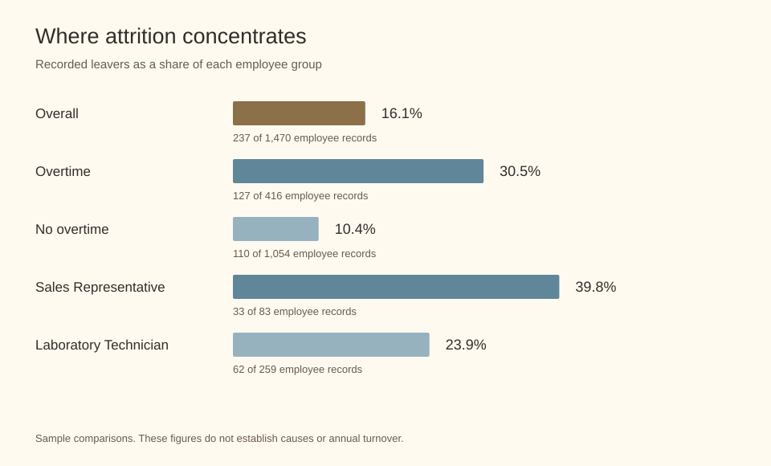

# Employee Attrition Analysis

Exploring employee attrition across roles, overtime, and experience, and turning the findings into a practical retention briefing.

**Moaaz Magdy | Power BI, SQL, Python, pandas, DuckDB**

**Confidential**

## The question

Where should HR investigate retention concerns first? An overall average hides differences between job roles, work patterns, and experience groups. This project combines data preparation, a Power BI reporting model, SQL segmentation, and a stakeholder briefing to make those differences easier to inspect.

## What I built

- Prepared employee and dimension tables for a reporting model.
- Built a Power BI report with overview, drill-down, and recommendation pages.
- Wrote DAX measures for counts, attrition proportions, and income comparisons.
- Used Python to classify experience levels and run SQL through DuckDB.
- Translated findings into proposed workload, onboarding, and compensation reviews.

## Selected findings

| Segment | Employee records | Recorded leavers | Attrition proportion |
|---|---:|---:|---:|
| Overall | 1,470 | 237 | 16.1% |
| Overtime: yes | 416 | 127 | 30.5% |
| Overtime: no | 1,054 | 110 | 10.4% |
| Sales Representative | 83 | 33 | 39.8% |
| Laboratory Technician | 259 | 62 | 23.9% |
| Junior experience: under 5 years | 228 | 75 | 32.9% |



These are descriptive comparisons within the supplied sample. They do not establish causes, future individual risk, annual turnover, or savings delivered. Experience means total working years, not tenure at this employer. Recommended interventions would need follow-up evaluation.

## Python and SQL together

Python loads prepared Excel tables into pandas. DuckDB registers those DataFrames as queryable relations in an in-memory SQL connection. SQL joins department and role dimensions to employee records, and `fetchdf()` brings the results back into pandas. This workflow does not update a persistent production database.

The public script is a cleaned adaptation of my original notebook. It adds input and join checks. The SQL includes employee counts and attrition proportions alongside the original leaver counts and income average so differently sized groups can be compared.

## Run locally

Use Python 3.10 or newer:

```bash
python -m pip install -r requirements.txt
python src/analyse.py data/prepared_data.xlsx --output outputs
```

Provide your own authorized workbook with `FactEmployee`, `DimDepartment`, and `DimJobRole` sheets. Required columns are documented by the validation rules in `src/analyse.py`. Original source records, assessment instructions, Excel assessment, submission documents, and PBIX are not distributed. Local data and outputs are gitignored.

## Repository guide

- `src/analyse.py`: pandas preparation, validation, experience groups, DuckDB execution.
- `sql/attrition_by_role.sql`: department and role aggregation.
- `powerbi/measures.dax`: reporting measures.
- `powerbi/README.md`: model and report structure.
- `reports/`: reviewed charts and analytical notes.

## Proposed next steps

Investigate workload in overtime-heavy teams, review support for early-career employees, and examine compensation and progression in roles with elevated attrition. Validate explanations through further evidence before choosing an intervention. No measured retention improvement or cost saving is claimed.
